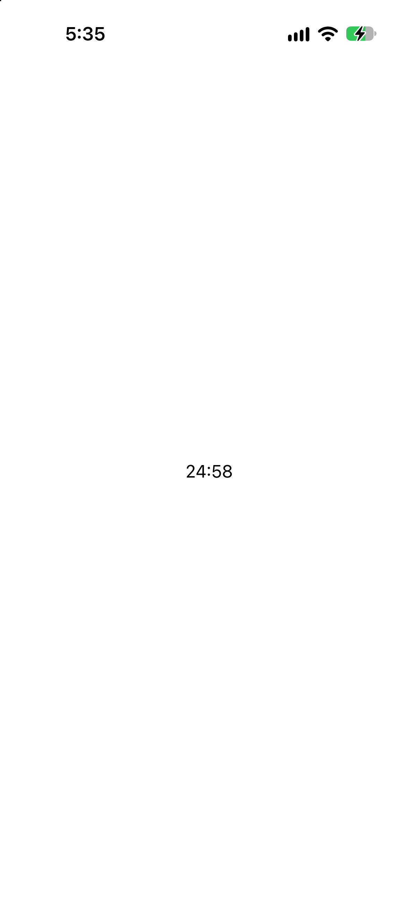
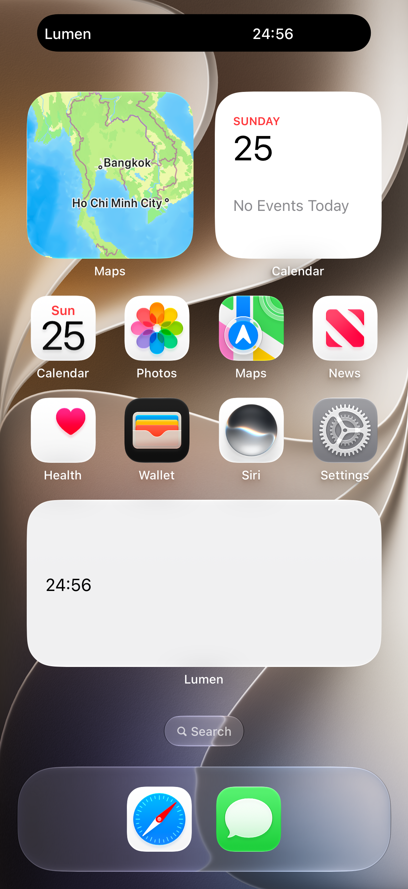
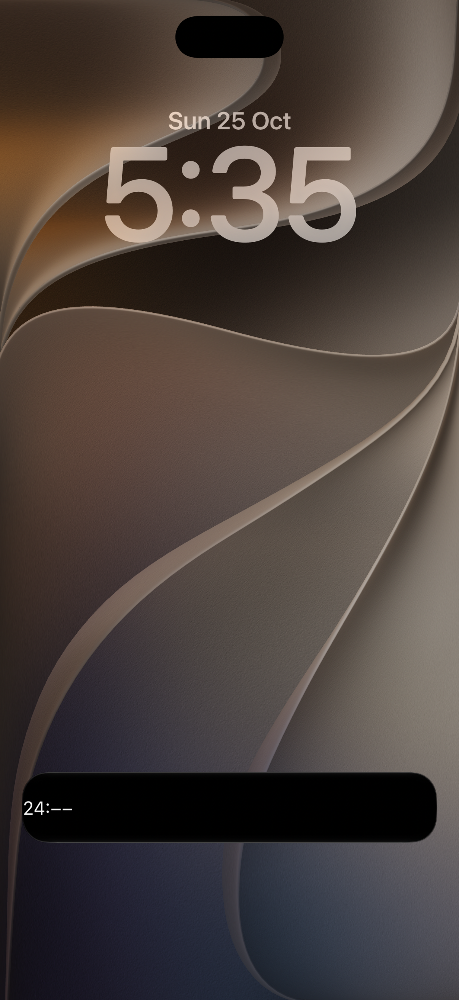

# Lumen

Lumen is a 25-minute focus timer. A session is the moment it ends. The screen, the home-screen widget, and the Live Activity all use that same date. The Start button and the Start Lumen shortcut both call `SessionModel.start()`.

## Run

1. Open `Lumen.xcodeproj` in Xcode 27 or later.
2. Choose an iPhone simulator.
3. Press Run.

The project uses Swift 6 and a deployment target of iOS 26. The first screen is a Start button. Start begins a session that ends 25 minutes later.

## Decisions

### The session stores an end date

`Session` is `idle` or `running(end: Date)`, `SessionModel.start()` adds `25 * 60` seconds to the current time once, and stores the result. The screen's remaining time is that date minus the current time. A stored count of seconds would sit still while the app is away. This date does not.

### The reminder uses that same date

On start, Lumen asks for alert and sound permission. When the answer is allowed, `scheduleNotification(at:)` builds a calendar trigger from the end date's year, month, day, hour, minute, and second. `repeats` is false, so the system delivers "Session ended" once, at that date.

### The widget reads that date from an App Group

`LumenWidgetExtension` is a separate target, so it cannot see the screen's session. `SessionStore` writes the end date into the App Group `group.me.khant.linthit.Lumen`. The widget reads that date and shows the time remaining. The Live Activity receives the same date in `SessionAttributes`.

## Screens

The countdown:

The widget on the Home Screen:

The Live Activity on the Lock Screen:

## Layout

- `Lumen/` contains the app, `Session`, `SessionModel`, and `SessionStore`.
- `LumenWidget/` contains the widget extension and the Live Activity.
- `Lumen.xcodeproj` is the Xcode project.
- `Screenshots/` holds the three images above.
